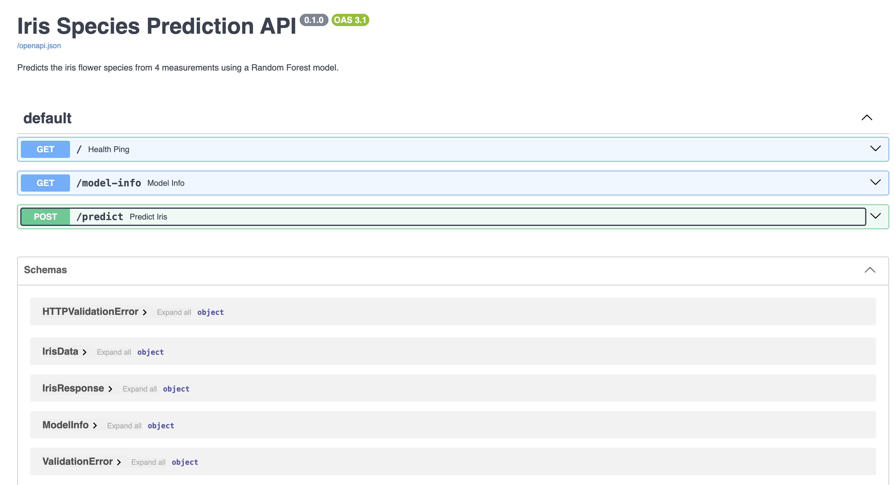

# FastAPI Lab

This is my version of the FastAPI lab from the course repo. The lab trains a model on the iris flower data and serves it as an API, so you can send flower measurements and get back the predicted species.

The iris data has 150 flowers from 3 species: setosa, versicolor and virginica. Each flower has 4 measurements in centimeters: sepal length, sepal width, petal length and petal width.

## Folder structure

```
FastAPI_Labs/
├── assets/
│   ├── docs_page.png      my screenshot of the updated API docs page
│   ├── docs.png           screenshot from the original lab
│   └── api_response.png   screenshot from the original lab
├── model/
│   └── iris_model.pkl     the trained model, created by train.py
├── src/
│   ├── __init__.py        empty file that marks src as a Python package
│   ├── data.py            loads the iris data and splits it into train and test
│   ├── train.py           trains the model, checks accuracy, saves it
│   ├── predict.py         loads the model once and makes predictions
│   └── main.py            the API itself, with all the endpoints
├── requirements.txt       the Python packages needed
└── README.md
```

## What each file does

**data.py** loads the iris data and splits it into two parts. 70% is used to train the model and 30% is kept aside to test it.

**train.py** trains a Random Forest on the training data, then tests it on the 30% it has never seen and prints the accuracy. It saves the model together with its type and accuracy into model/iris_model.pkl.

**predict.py** loads the saved model once when the API starts. When a prediction is needed, it returns the class number, the species name and how confident the model is. It also has a small function that returns the model's details for the /model-info page.

**main.py** is the API. It defines what input the API accepts, checks that the input makes sense, and sets up three endpoints:

| Endpoint | Type | What it does |
|---|---|---|
| / | GET | Checks that the API is running |
| /model-info | GET | Shows the model type, its accuracy and the species it knows |
| /predict | POST | Takes 4 measurements and returns the predicted species |

## How it works

1. Run train.py once to train the model and save it.
2. Start the API with uvicorn. It loads the saved model.
3. Send 4 measurements to /predict.
4. The API checks the numbers, passes them to the model and sends back the species name and confidence.

## What I changed

1. I changed the model from a Decision Tree to a Random Forest. The original code never checked accuracy, so I added that. The model got 97.78% on the test data, which is 44 out of 45 test flowers.
2. The API now returns the species name and how confident the model is, not just a number.
3. The API now rejects bad input. Before, you could send all zeros and still get an answer. Now each measurement has to be between 0 and 10.
4. I added a /model-info page that shows the model type and its accuracy.
5. The model now loads once when the API starts, instead of on every request.

I also fixed the run command in the original instructions (it should be `uvicorn main:app`), made the file paths work from any folder, and updated requirements.txt so it installs on newer Python.

## Example

Sending this to /predict:

```
{"sepal_length": 6.7, "sepal_width": 3.0, "petal_length": 5.2, "petal_width": 2.3}
```

Gives back this:

```
{"class_id": 2, "species": "virginica", "confidence": 0.9911}
```

Sending all zeros now gives an error saying each value should be greater than 0, instead of a prediction.

Calling /model-info gives:

```
{"model_type": "RandomForestClassifier", "test_accuracy": 0.9778, "species": ["setosa", "versicolor", "virginica"]}
```

## How to run

From the FastAPI_Labs folder:

```bash
python3 -m venv .venv
source .venv/bin/activate
pip install -r requirements.txt
cd src
python train.py
uvicorn main:app --reload
```

Then open http://127.0.0.1:8000/docs in your browser. You can try all three endpoints there.

## Screenshot

