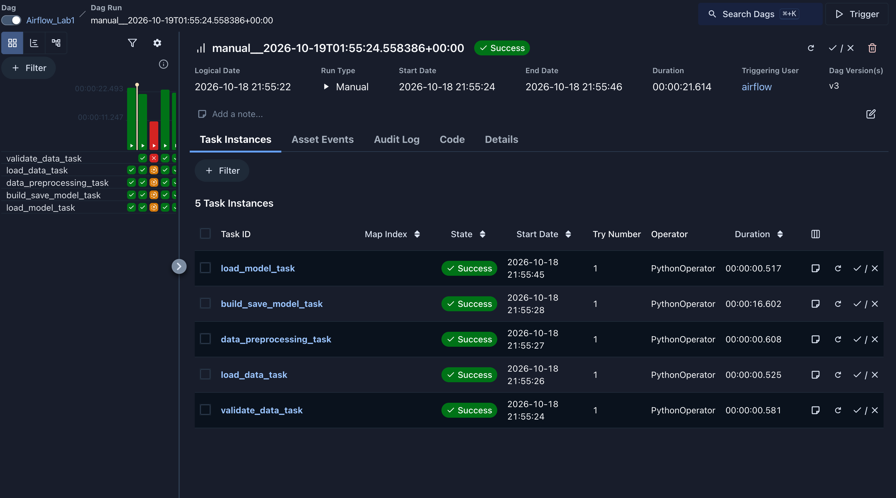

# Airflow Lab 1: Customer Clustering Pipeline

This lab is based on Airflow Lab 1 from the MLOps course repository. The original lab uses Apache Airflow to run a K-Means clustering pipeline on credit card customer data. I ran the original version first, looked closely at its output, fixed two problems I found, and added a few improvements to make the pipeline more reliable.

## What the pipeline does

The data has about 9,000 credit card customers. The pipeline groups similar customers together based on their balance, purchases and credit limit. Airflow runs the work as five tasks, one after another:

**validate data → load data → preprocess data → build and save model → predict**

If any task fails, Airflow stops and the tasks after it do not run.

## What I changed

**1. Added a validation task.** Before anything else runs, a new task checks that the data file exists, is not empty and has the columns the pipeline needs. If something is wrong, the pipeline stops right away with a clear message. I tested this by asking for a column that does not exist, and the pipeline stopped at the first task as expected.

**2. Fixed which model gets saved.** The original code tried 49 different numbers of groups and then saved the last one it tried, which was always 49. The elbow method actually picked 8 as the best number, but that answer was never used. Now the pipeline picks the best number first and saves a model with 8 groups.

**3. Scaled the test data.** The model was trained on numbers scaled between 0 and 1, but the test customer was given to the model as raw numbers. Now the pipeline saves the scaler from training and uses it on the test customer before making a prediction, so both are measured the same way.

**4. Added retries.** If a task fails because of a temporary problem, Airflow now tries it again up to two more times before giving up.

I also cleaned up the code a little. The required columns are now written in one place, I removed an old debug message and an outdated note, and I updated the comments so they match what the code does.

## Results

Before my changes, the saved model had 49 groups and the test customer was placed in group 5. After my changes, the saved model has 8 groups, matching the elbow method, and the test customer is placed in group 6.

One thing I noticed after adding scaling: the test customer's credit limit came out as 8.06 on a scale where the training data only goes up to 1. That means their credit limit is about 8 times higher than any customer the model learned from, so the prediction for this customer is not very reliable. I kept the original test file, but this is a good example of why it matters to check that new data looks like the training data.

## How to run it

You need Docker Desktop running with at least 4 GB of memory. From the Lab_1 folder, run:

```bash
mkdir -p ./logs ./plugins
echo "AIRFLOW_UID=$(id -u)" > .env
docker compose up airflow-init
docker compose up -d
```

Then open http://localhost:8080 in your browser and log in with username airflow and password airflow. Turn on Airflow_Lab1 and click Trigger.

The docker-compose file is the official Airflow 3 file with two small edits: the example pipelines are turned off, and it installs pandas, scikit-learn and kneed, which the code needs.

To stop Airflow, run `docker compose down`.

## Screenshot

All five tasks finishing successfully:

