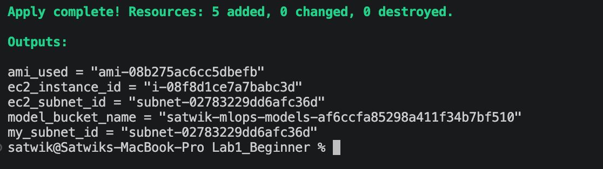
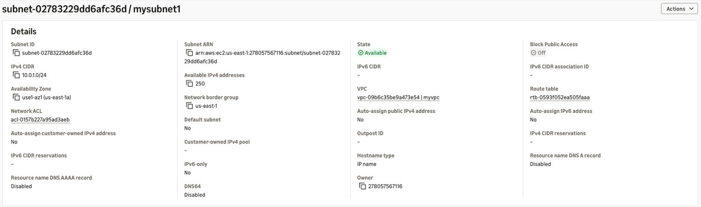
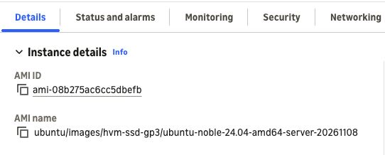
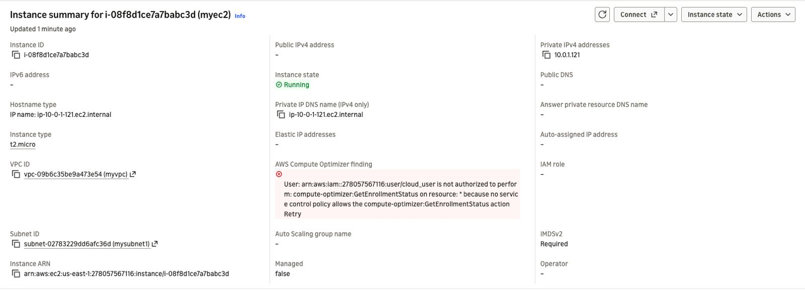
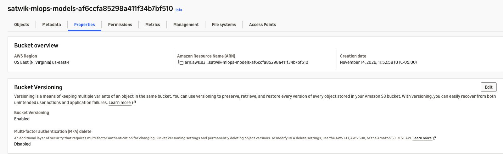
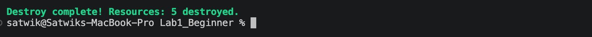

# My Changes to This Lab

I ran the original lab first, then made 5 changes and tested each one with `terraform plan` before applying.

## 1. EC2 now runs inside our own subnet
In the original lab, the VPC and subnet were created but the EC2 was not connected to them, so it went into AWS's default network. I added `subnet_id = aws_subnet.mysubnet1.id`.
**Proof:** the outputs `ec2_subnet_id` and `my_subnet_id` show the same ID, and the console shows the EC2 in `mysubnet1` with private IP 10.0.1.121.

## 2. Machine image (AMI) is looked up, not hardcoded
The original used a fixed AMI ID. I replaced it with a `data "aws_ami"` block that finds the latest official Ubuntu 24.04 (amd64) image from Canonical.
**Proof:** Terraform picked `ami-08b275ac6cc5dbefb` (published Nov 8, 2026), which is newer than the hardcoded ID.

## 3. S3 bucket for model files, with versioning
Added a bucket to store trained models. Versioning is on, so older model versions are kept.
`bucket_prefix` gives it a unique name automatically.

## 4. Variables and outputs
- `variables.tf`: region and instance type in one place.
- `outputs.tf`: prints the EC2 ID, subnet IDs, AMI and bucket name after apply.

## 5. Provider version pinned
Added a `required_providers` block (`~> 6.0`) so a future AWS plugin v7 can't break the code.

## Known limits
- The VPC has no internet gateway, so the EC2 has no internet access. This was fine for this lab.
- `force_destroy = true` on the bucket is fine for a lab but risky for real model storage.
- Done in a course AWS sandbox (TA approved).

## Screenshots

**Apply with outputs** (subnet IDs match)

**EC2 inside myvpc / mysubnet1**

**AMI found by lookup**

**Subnet details**

**S3 versioning enabled**

**Destroy complete**

---